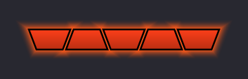

<p align="center"></p>

# Nameplate Combos

A small World of Warcraft addon for **WoW Forever (1.60.1)** that shows your combo points right under your current target's nameplate.

Works for **Rogues** and **Druids in Cat Form**. For other classes it does nothing.


At max combo points the bar glows (pulsing by default):



## Features

- Combo points sit directly under the target's health bar and follow the nameplate.
- Interlocking trapezoid pips that form one continuous bar.
- Different color at max combo points, plus an optional glow or pulse.
- Shows only for attackable, living targets. For druids, only in Cat Form.
- Options panel with a live preview, opened from a minimap button or `/ncp`.
- Settings are saved per character.

## Install

1. Download the addon:
   - **Code → Download ZIP** on GitHub and unzip it, or
   - `git clone git@github.com:4Tr3Yu/nameplate-combos.git`
2. Copy the **`NameplateCombos`** folder (the one containing `NameplateCombos.toc`) into your WoW Forever AddOns folder:

   ```
   World of Warcraft/<forever client folder>/Interface/AddOns/NameplateCombos/
   ```

   The folder name must be exactly `NameplateCombos`, and the `.toc` file must sit directly inside it, not one level deeper. If you downloaded the ZIP, GitHub wraps everything in a `nameplate-combos-main` folder, so copy only the `NameplateCombos` folder from inside it.

3. **Restart the game** (not just `/reload`). The game only picks up new addon folders and image files on a full restart.
4. On the character select screen, open **AddOns** and make sure **Nameplate Combos** is enabled.
5. In game, turn on **enemy nameplates** (default key **V**). The combo points draw on the nameplate, so nothing shows without them.

### Updating

Replace the `NameplateCombos` folder with the new one and restart the game.

## Usage

Target an enemy as a Rogue or in Cat Form. The pips appear under its nameplate.

**Options:** click the minimap button, or type `/ncp`.

| Section | Option |
|---|---|
| Colors | Combo point, max combo points, empty |
| Appearance | Opacity, height, spacing, vertical offset |
| Max combo points | Glow on/off, pulse or steady, pulse duration, glow color |
| General | Show empty pips, show minimap button |

Drag the minimap button to move it around the minimap.

### Slash commands

```
/ncp                 open the options panel
/ncp size <4-30>     pip height
/ncp spacing <0-10>  gap between pips
/ncp y <number>      vertical offset (negative = lower)
/ncp empty           toggle showing empty pips
/ncp minimap         toggle the minimap button
/ncp reset           restore defaults
```

## Troubleshooting

- **Listed as "Incompatible" or "Out of date":** the client version doesn't match the `## Interface:` line in `NameplateCombos.toc` (currently `16001` for 1.60.1). To find your client's number, run this in game:

  ```
  /script DEFAULT_CHAT_FRAME:AddMessage(table.concat({GetBuildInfo()}, " | "))
  ```

  Put the last number it prints on the `## Interface:` line, or tick **Load out of date AddOns** in the AddOns list.
- **Nothing shows:** check that enemy nameplates are on, that you're a Rogue or in Cat Form, and that the target is hostile and alive.
- **Pips show as solid green squares:** the game can't find the images. Check that `NameplateCombos/media/` exists and restart the game.
- **Lost the minimap button:** type `/ncp` and tick **Show minimap button**.

## Development

The pip and glow images in `NameplateCombos/media/` are generated. To change the slant, outline or glow, edit the constants at the top of `tools/make_textures.py` and run:

```
python3 tools/make_textures.py
```

The logo (`docs/logo.png`) and the in-game icon (`NameplateCombos/media/icon.tga`, used for the minimap button and the AddOns list) come from `tools/make_logo.py`:

```
python3 tools/make_logo.py
```

If you change the texture size or slant, update `PIP_ASPECT` and `SLANT_RATIO` in `NameplateCombos.lua` to match.
